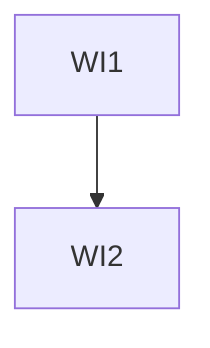

# <project-name> Implementation Roadmap

> Source: `docs/requirements/`, `docs/design/`. Format rules: `docs/guides/roadmap-authoring.md`.

## Purpose

Milestone index and work-item status surface from design to implementation. After reading it, an AI or maintainer knows which work items are done (checkbox) and which remain, without re-walking every doc and the codebase. It contains no implementation detail — per-item action contracts live in the delivering plans under `docs/plans/implementation/`.

> This roadmap is optional. Small projects can delete it and work from `docs/requirements/` directly.

## Work Item Status

A work item is done iff its checkbox is `[x]` (closure audit passed). "Draft-reviewed and queued" is carried by the delivering plan's `status: active`, not by a status value here.

### M1 — <name>

- [ ] WI1 <work item> (Owner: `docs/design/<path>`; deps: —)
- [ ] WI2 <work item> (Owner: `docs/design/<path>`; deps: WI1)

### M2 — <name>

- [ ] WI3 <work item> (Owner: `docs/design/<path>`; deps: M1)

## Framework / Platform Reuse

Capabilities already provided by the stack, so the project does not rebuild them:

- <capability — provided by <module/package/service>>

## Current Baseline

**Already implemented:**

- 

**Main gaps:**

- 

## Dependency Graph

## Cross-Cutting

| Concern | Notes |
| --- | --- |
| Error handling | <convention> |
| Permissions | <convention> |
| Testing | <convention> |
| Owner-doc sync | update design/architecture when a work item closes |
| Dev log | update `docs/logs/` after each implementation |

## Rules

- This file is a status index and coarse-grained split, not an implementation specification.
- Status lives on work-item checkboxes only; a milestone never carries a status; no status tables or suffixes.
- Work-item ids `WI<n>` increment file-globally.
- AI takes the first unchecked work item in order and delivers it via a plan under `docs/plans/implementation/` (independent execution + independent closure audit); the checkbox is ticked only after the audit passes. Humans steer; AI does not re-arbitrate priority or invent work items.
- When the last work item is ticked, run the completion bugs/lessons summary (`docs/guides/roadmap-authoring.md`).
